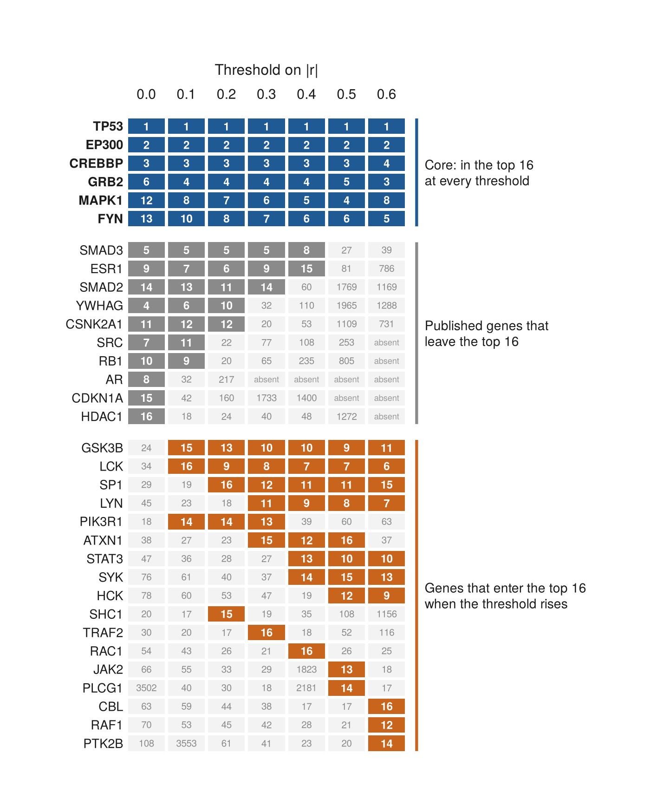

# SM13: Control theory analysis with gene expression

The network driver genes of the article were obtained from the structure of the general human PPI network. This folder adds the analysis in which gene expression is used: an interaction is kept only when its two genes are correlated across patients, and the control theory analysis is repeated at seven correlation thresholds.

**Read first:** [`SM13_Control_Theory_Gene_Expression.pdf`](SM13_Control_Theory_Gene_Expression.pdf)

## Main results

| Group of genes | Genes |
|---|---|
| Core genes, in the top 16 at every threshold | TP53, EP300, CREBBP, GRB2, MAPK1, FYN |
| Published genes that leave the top 16 as the threshold rises | SMAD3, ESR1, SMAD2, YWHAG, CSNK2A1, SRC, RB1, AR, CDKN1A, HDAC1 |
| Genes that enter the top 16 at one or more thresholds | GSK3B, LCK, SP1, LYN, PIK3R1, ATXN1, STAT3, SYK, HCK, SHC1, TRAF2, RAC1, JAK2, PLCG1, CBL, RAF1, PTK2B |



## How to read these lists

- At every threshold the 16 top genes are the 16 most connected proteins of that network.
- In whole blood, random pairs of genes pass the correlation filter almost as often as interacting pairs (32.5% against 37.3% at the threshold 0.3).
- The comparison with 27 recovered patients, using shuffled group labels, found no difference beyond chance.

The genes that enter the top 16 are therefore candidates for further study. They are not shown to be specific to Long COVID.

## Files

| File | Content |
|---|---|
| `SM13_Control_Theory_Gene_Expression.tex`, `.pdf` | The supplementary document |
| `validation.md` | Check of the R function against the reference software and against a published result |
| `figures/` | Figures 1 to 4 (PDF and PNG) |
| `tables/threshold_summary.tsv` | Network size, driver nodes and classes per group and threshold |
| `tables/top16_by_threshold_LongCOVID.tsv`, `tables/top16_by_threshold_recovered.tsv` | The 16 top genes per threshold |
| `tables/top16_genes_across_thresholds.tsv` | Rank and connections of each top gene at every threshold, with its group (core, published, new) |
| `tables/all_genes_by_threshold_LongCOVID.tsv` | Every gene at every threshold: connections, Type I, Type II, score |
| `tables/*.tex` | The same tables for the LaTeX document |
| `data/ppi_correlations.tsv` | Spearman correlation of each PPI interaction in each group |
| `data/control_*.tsv` | Results of the controls that need the patient level data |
| `data/gene_roles.tsv` | Short description of the known role of each gene (background, not a result) |

## Reproduce

```bash
Rscript Code/test_control_theory.R          # tests of the function
Rscript Code/ControlTheory_expression.R     # all tables and figures of this folder
```

The script starts from `data/ppi_correlations.tsv`. To start from expression data, see the header of the script.

## Data access

The expression matrix is public (GEO GSE215865). The clinical data are under controlled access (Synapse) and are not in this repository. The files in `data/` contain summaries only: no file has one row per participant.
